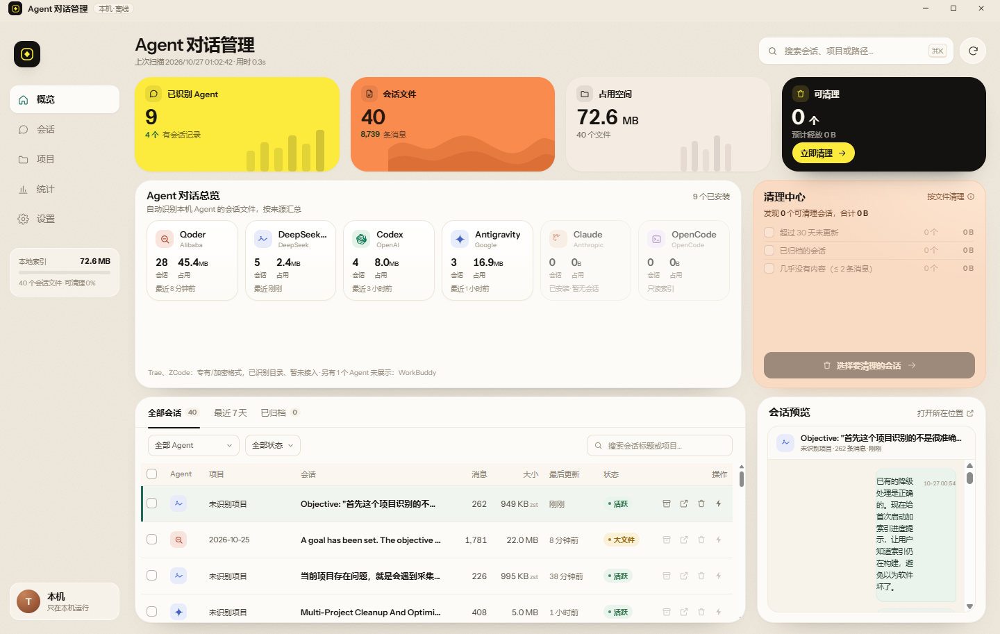

# 🛡️ AgentHub

<p align="center">
  <b>本地 AI 编程 Agent 对话与资产管理管家</b><br>
  一键聚合、搜索、备份 Claude Code / Codex / Antigravity / Qoder 海量会话 · 极速清理释放几十 GB 磁盘空间
</p>

<p align="center">
  
  
  
  
  
  
</p>

<p align="center">
  <a href="https://github.com/zhangtt08/agent-hub/releases/latest"><b>🚀 [点击立即下载 Windows 安装版 / 绿色版]</b></a>
</p>

<p align="center">
  
</p>

---

## ⚡ 为什么需要 AgentHub？

当你在日常开发中重度使用 **Claude Code**、**OpenAI Codex**、**Google Antigravity** 或 **Qoder** 时，你一定会遇到以下痛点：

1. **磁盘空间悄悄爆满**：每个 Agent 都会把完整的多轮上下文、Tool 调用记录、代码补丁全量缓存在本地。不知不觉中，单个 Agent 就能吃掉你 **10GB ~ 50GB** 的 C 盘空间！
2. **曾经问过的神级 Prompt 和解法找不到了**：会话散落在不同目录的 SQLite、JSONL 或 Zstandard 压缩包里，想要复用之前的架构设计思路犹如大海捞针。
3. **普通清理软件不敢删**：担心手滑删错文件导致 Agent 崩溃或丢失关键开发历史。

**AgentHub 就是为此而生的终极管家！**  
基于 Tauri 2 + Rust 打造，体积小、秒开、零后台常驻，帮你将电脑里的所有 AI 编程资产打理得井井有条。

---

## ✨ 核心特性

- 🔍 **全量 Agent 自动扫描识别**：自动探测本机安装的各大 AI 编程工具会话目录，无需手动配置路径。
- 🔎 **全量内容极速检索**：跨工具、跨项目全文搜索历史提问与回复，毫秒级召回历史代码思路。
- 🧹 **安全智能瘦身清理**：清晰统计各 Agent 占用的磁盘体积；支持一键将过期旧会话**移入回收站**（可随时撤回），彻底释放海量磁盘空间！
- 📦 **会话导出与长久归档**：重要项目交付后，可将全量 Agent 交互记录一键导出归档保存。
- 🔒 **100% 本地离线私密**：不联网、不上传任何数据，你的私密代码和会话记录绝不离开你的电脑。
- 🤖 **原生 MCP 服务**：支持作为 MCP Server 接入，让智能体自己查询历史知识。

---

## 💻 支持的 AI 编程 Agent

| 智能体 / 工具 | 会话存储格式 | 支持能力 |
| :--- | :--- | :--- |
| **Codex** | Sessions JSON | 会话列表 / 标题解析 / 全文搜索 / 安全清理 |
| **Claude Code** | 会话历史缓存 | 统一浏览 / 耗费 Token 统计 / 归档与清理 |
| **DeepSeek Harness** | `session.v4.jsonl.zstd` 多帧压缩包 | 高速流式解压预览 / 清理释放空间 |
| **Antigravity** | 会话数据库 `*.db` | 标题与首条提问识别 / 全库统计与清理 |
| **Qoder** | `main.sqlite` 数据库 | 项目索引 / 消息数统计 / 归档 |
| **WorkBuddy / OpenCode** | 本地数据库 | 索引与内容极速预览 |

---

## 📥 下载与快速开始

### 方式一：下载即用（推荐）
前往 **[Releases 页面](https://github.com/zhangtt08/agent-hub/releases/latest)** 下载：
- **`AgentHub-Setup.exe`**：标准安装版，自动在开始菜单生成快捷方式，支持一键卸载；
- **`AgentHub.exe`**：绿色便携版，双击直接运行，不写注册表。

> **系统要求**：Windows 10/11 x64（需要系统自带的 WebView2 运行时，Win11 已默认内置）。

### 方式二：开发者本地构建
```bash
# 需要 Rust 与 Node.js
git clone https://github.com/zhangtt08/agent-hub.git
cd agent-hub
npm install
npm run tauri dev
```

---

## ⭐ 支持与致谢

如果你觉得 AgentHub 帮你拯救了 C 盘空间或者找到了关键历史会话，请给项目点亮一个 **Star ⭐**！

## 📄 开源许可证
本项目基于 [MIT License](LICENSE) 协议开源。
